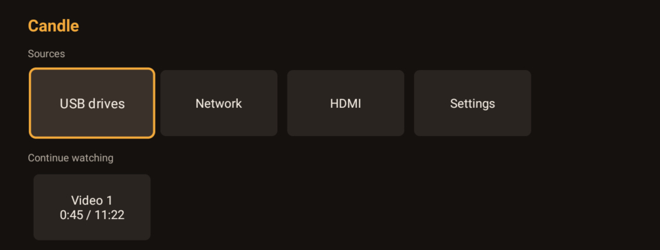
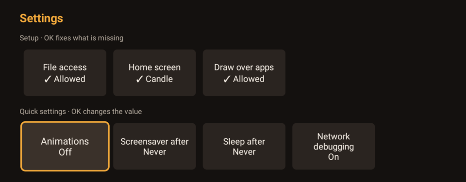
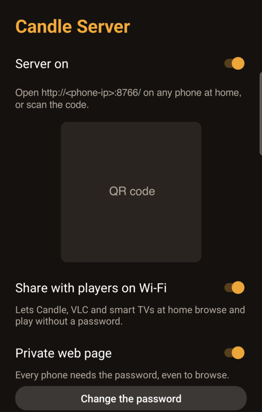

# Candle

Two small Android apps for watching your own files on a cheap projector:

- **Candle** is a lightweight home screen and media player for Android TV projectors such as the
  **HY300** (Android 11, 32-bit, ~1 GB RAM). It plays videos, music, photos and PDFs from USB
  drives, SMB shares and DLNA servers, lets a phone act as the remote, and accepts videos sent
  from phone apps. It uses less memory than the stock launcher.
- **Candle Server** turns an Android phone (Android 12 or newer), for example an old one left on
  its charger, into the house media server: DLNA for Candle, VLC and smart TVs, and a web page
  where any phone at home can browse, play, download and upload.



## Install

Download `candle-<version>.apk` and `candle-server-<version>.apk` from the
[Releases](https://github.com/uminocelo/candle/releases) page.

**Candle on the projector.** Most projectors have no browser or file manager for installing
apps, so install from a computer with [adb](https://developer.android.com/tools/releases/platform-tools):

1. On the projector: Settings → Device Preferences → About → press OK on *Build* seven times,
   then Developer options → turn on *Network debugging* (or *USB debugging*).
2. On the computer: `adb connect <projector-ip>:5555`, then `adb install candle-<version>.apk`.

If your projector has a file manager, copying the APK to a USB stick and opening it there also
works.

**Candle Server on the phone.** Open the APK on the phone (allow your browser or file manager to
install apps when Android asks).

## Candle

### First run

Candle opens **Settings → Setup** by itself the first time, with what is still missing:



- **File access**: needed to read USB drives. OK opens Android's screen for it; on projectors
  that have no such screen (the HY300 is one), Candle shows the one adb command to run from a
  computer: `adb shell appops set com.uminocelo.candle MANAGE_EXTERNAL_STORAGE allow`.
- **Home screen**: OK asks Android to make Candle the home screen, so it is the first thing you
  see after every power-on. The old launcher stays installed; choose it again the same way.
- **Draw over apps**: only for the phone remote (its PIN and its Home button).

The quick settings (animations, screensaver, sleep, network debugging) need one more adb grant,
shown on that screen when it is missing.

### Watching

- **USB drives**: OK opens a folder, a video, a song, a photo or a PDF; Back goes up a folder.
  Opening a song queues its whole folder.
- **Network**: **Add SMB server** with the computer's IP address (`.local` names may not resolve
  on the projector), the share name, and a user name and password (empty user name for guest
  access). The password is encrypted with a key kept in the Android Keystore. Hold OK on a server
  (or press Menu) to edit or remove it; leaving the password empty when editing keeps the saved
  one. DLNA media servers (Plex, Jellyfin, minidlna, most NAS boxes, Candle Server) appear by
  themselves below, tagged "DLNA": the list shows the servers found last time at once and
  refreshes after a 3-second search. DLNA items play the server's original file, not a transcode.
- **Continue watching** on the home screen resumes videos where you stopped.

Sharing a folder from a Mac over SMB: System Settings → General → Sharing → File Sharing → ⓘ →
add the folder, then Options… → "Share files and folders using SMB" and tick the account under
Windows File Sharing. A login that fails shows "Wrong user name or password".

Remote keys: in videos, OK plays/pauses, ◀ ▶ seek 10 s, and holding OK (or Menu) picks the audio
and subtitle tracks. In music, OK plays/pauses, ◀ ▶ previous/next, ▲ shuffle, ▼ repeat, and
Back keeps it playing. Photos: ◀ ▶ previous/next, OK starts or stops a slideshow. PDFs: ◀ ▶ turn
pages and Candle remembers the page; EPUB and other documents open from a phone instead.

### Phone remote

**Settings → Phone remote** starts a small web page on the projector. Scan the QR code shown there
with the phone's camera (no app to install), then pair once with the 4-digit PIN shown on the
projector. The **Remote** tab has the D-pad, OK, Back, Home, seek, play/pause and volume under a
now-playing card; the **Library** tab browses USB, SMB and DLNA sources and plays a file on the
projector. **Forget phones** signs every phone out.

**Accept videos from phones** lets apps that can send to a DLNA/UPnP player (for example
BubbleUPnP or Web Video Caster) play videos on Candle, with pause, seek, stop and volume from the
phone.

### USB drives

Filesystems on the HY300 (tested 2026-10-28 with `sm list-volumes` and `mount`):

| Filesystem | Result | Notes |
| --- | --- | --- |
| FAT32 (vfat) | Mounted read-write | Android checks the drive and mounts it about 3 s after it is plugged in; Candle lists it at once |
| exFAT | Not tested yet | The system has exFAT support (`mount.exfat`, `fsck.exfat`), so it is expected to mount |
| NTFS | Not tested yet | The system has NTFS support (`ntfs-3g`), so it is expected to mount |

If a drive does not show up, reformat it as **exFAT** (FAT32 cannot hold files over 4 GB). On
macOS: Disk Utility → View → Show All Devices → the drive → Erase → Master Boot Record + ExFAT
(this deletes everything on it). Pulling a drive out mid-playback closes the video with a message
(the position is saved), stops music playing from it, and returns to the drive list.

On the HY300 the USB-A port can also act as a *device* port for debugging, and then it reads no
drives at all; turning on debugging in Developer options can switch it. To set it back to reading
drives (takes effect at once and survives reboots):

```sh
adb shell setprop persist.sys.usb0device 0
```

### Settings

Home → **Settings** has the Setup checklist; **quick settings** where OK cycles the value
(animations, screensaver delay, sleep delay, network debugging; turning network debugging off asks
first); **More settings** tiles that open system and vendor screens (Wi-Fi, Bluetooth, projector
picture and keystone, picture and sound, date and time, storage, apps, all settings; screens the
device does not have are hidden); **About Candle**; and a **Device** panel with the IP address,
free memory, storage, USB drives and versions.

To go back to the old launcher without a computer: Settings → Apps → Default apps → Home app (when
your TV's settings show it), or uninstall Candle and Android falls back to it.

### Safety

On the HY300, network debugging lets **anyone on your Wi-Fi** control the projector without
asking. Turn it off again when you are done (Candle's quick settings have a tile for it).

## Candle Server



On first start, a **Finish setting up** card asks for **access to all files** (to share
documents) and to **keep running in the background** (so Android does not pause the server with
the screen off). It goes away once both are allowed. Then:

- **Share with players on Wi-Fi**: Candle, VLC and smart TVs at home browse and play the shared
  folders over DLNA, without a password.
- **The web page**: open the address shown (or scan the code) on any phone or computer at home to
  browse, search, play, view photos and PDFs, and download. Uploads go into the folder you have
  open (or *Candle Uploads* at the top level).
- **Private web page**: with a password set, every phone needs it, even to browse. A login lasts
  30 days; five wrong passwords lock that device out for 5 minutes. Uploads always need the
  password.
- **Shared folders**: tick which top-level folders are shared (DCIM, Documents, Download, Movies,
  Music and Pictures at first).

The server only answers on your home network; do not forward its port to the internet.

## HY300 extras

For advanced users, `scripts/` has adb scripts that remove unneeded preinstalled apps from the
HY300 to free memory, check that HDMI, the Play Store and YouTube still work after each step, and
put everything back (`scripts/restore.sh`). Read [CONTRIBUTING.md](CONTRIBUTING.md) before using
them.

## Building

See [CONTRIBUTING.md](CONTRIBUTING.md).

## Licence

Copyright © 2026 uminocelo. Candle and Candle Server are free software under the
[GNU General Public License, version 3 or later](LICENSE), with no warranty. They include the
libraries listed in [THIRD_PARTY.md](THIRD_PARTY.md); both apps show these on their About screen.
